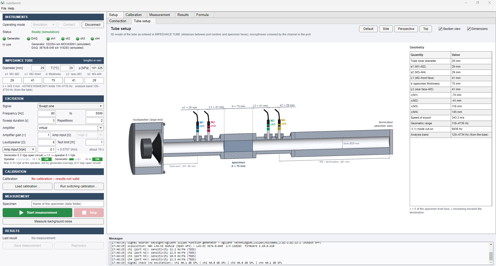
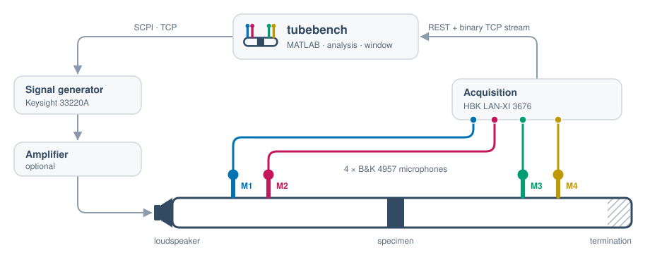

<p align="center">
  <picture>
    <source media="(prefers-color-scheme: dark)" srcset="resources/logo/tubebench-mark-reverse.svg">
    
  </picture>
</p>

<h1 align="center">tubebench</h1>

<p align="center">
  <strong>Four-microphone impedance-tube measurements in MATLAB</strong><br>
  transmission loss · reflection · transfer impedance · transfer matrix
</p>

<p align="center">
  <a href="LICENSE"></a>
  
  
  
  
  
</p>

<p align="center">
  <a href="#quick-start">Quick start</a> ·
  <a href="#features">Features</a> ·
  <a href="docs/user_guide.md">User guide</a> ·
  <a href="docs/theory.md">Theory</a> ·
  <a href="#project-status">Status</a> ·
  <a href="#citing">Cite</a>
</p>

---

**tubebench** drives a signal generator and a multichannel acquisition module, records four
microphones around a specimen in an impedance tube and computes the specimen's acoustic
properties after ASTM E2611, with a validity verdict for every frequency line. It includes a
complete virtual tube, so every feature, the window included, also runs without hardware.

<p align="center">
   Tube setup with the 3D model of the lab tube" width="100%">
  <br><sub>Setup › Tube setup: the 3D model follows the geometry entered in the window, and the analysis band
  follows the ASTM E1050 / E2611 limits of the tube (simulation mode).</sub>
</p>

## Features

- **One window for the whole workflow.** Connect → tube geometry → excitation → switching
  calibration → measurement → save. Every step has its own view (header, graphs, summary table),
  and the Formula tab shows every equation with its source.
- **Four-microphone analysis.** Wave decomposition; reflection and transmission coefficients,
  transmission loss, thin-element transfer impedance and the two-port transfer matrix. Visco-thermal
  tube losses (Kirchhoff) by default, ISO 10534-2 attenuation as an option.
- **Two-load transfer matrix (ASTM E2611).** Load A, load B and load A again, chosen in the window
  (absorber, rigid cap or open end, at the tube end or the joint) and guided step by step: no
  anechoic termination needed. The transmission loss, the anechoic and the hard-backed absorption
  and the matrix itself, with the condition of the loads and a check that nothing moved.
- **Validity per frequency line.** Lines that the tube geometry, the calibration, the signal
  quality or the termination do not support are masked, and the program says why. The analysis
  band can follow the ASTM E1050 / E2611 limits of the tube geometry.
- **Three excitations.** Swept sine (log or linear), stepped sine and random noise.
- **No shared clock needed.** Generator and acquisition are not synchronised; every action is
  scheduled on the samples received, and a matched-filter sweep gate keeps the generator's
  switching clicks out of the analysis.
- **Guided switching calibration.** Twelve operator steps that swap the microphones, ending with
  an automatic empty-tube check.
- **Traceable data.** Raw volts are never modified or overwritten; every measurement stores its
  configuration, calibration, software version and git commit. Results export to CSV, figures to
  PNG, PDF, SVG or FIG.
- **Runs without hardware.** Protocol-level mocks of the instruments on an analytic tube model.
  The automated tests exercise the whole workflow, including the window, and replay recorded
  responses of a real LAN-XI module.
- **Pluggable instruments.** Drivers implement a small contract; templates and a Claude Code skill
  add a new instrument without changes to the session or the window.
- **Operator prompts in English and Korean.**

https://github.com/user-attachments/assets/815febda-de94-4d78-855e-cb60f887468e

<p align="center"><sub>Switching calibration on the virtual tube (pauses for the measurements shortened): the
microphones swap between the calibration ports M1 (a) and M2 (b), each one staying on its own cable and
input channel; the empty-tube check (Test E) closes the sequence.</sub></p>

## Quick start

**Requirements:** MATLAB R2022b with the Signal Processing Toolbox (nothing else; tested on
Windows). Instrument communication uses base MATLAB (TCP, HTTP).

```bash
git clone https://github.com/kimwoongji/tubebench.git
```

Try it without hardware, in MATLAB from the `tubebench` folder:

```matlab
tubebench sim                    % the window on a virtual tube
```

| Command | What it does |
|---|---|
| `tubebench` | the window on the real instruments (`config/user_config.json`) |
| `results = run_tests();` | self-test in simulation, report in `tests/last_test_report.txt` |
| `edit start_here.m` | the workflow as a script, step by step, without the window |
| `run examples/demo_simulation.m` | full simulated workflow with example plots |

On Windows, **`start_tubebench.bat`** starts MATLAB without its desktop and opens the window
(`start_tubebench.bat sim` for the virtual tube). The [user guide](docs/user_guide.md), also in the
window under Help > User guide, describes every control and view.

**Configuration.** [`config/user_config.json`](config/user_config.json) holds the settings of the
author's lab (instrument addresses, limits, microphones, tube geometry); it is tracked in git as a
working example. [`config/example_config.json`](config/example_config.json) is a neutral template.
The window saves the configuration under File > Save configuration…. Commit code and configuration
before measuring: the commit stored with a measurement does not see uncommitted changes.

## How it works

<p align="center">
  <picture>
    <source media="(prefers-color-scheme: dark)" srcset="docs/images/measurement_chain-dark.svg">
    
  </picture>
</p>

`meas = session.measure()` records raw volts; `res = tim.app.processMeasurement(meas, cfg, cal)`
then

1. computes the relative responses between the channels for the excitation used (sweep
   deconvolution, stepped-sine estimates or Welch averaging);
2. applies the complex switching calibration;
3. maps the acquisition channels to the tube positions M1..M4;
4. decomposes the waves and computes R, τ, TL, the transfer impedance and the validity masks.

The derivations, estimators, frequency limits and validity levels are in
[docs/theory.md](docs/theory.md).

## Supported instruments

The configuration names a driver for each role (`generator.driver`, `daq.driver`). The window
has no instrument selector; it shows the instruments in use with the model, serial number and
firmware they report.

| Driver | Role | Instrument | Mode |
|---|---|---|---|
| `keysight33220a` | signal source | Keysight/Agilent 33220A (SCPI over TCP) | hardware and simulation |
| `lanxi` | acquisition | HBK LAN-XI Light 3676 (Open API) | hardware and simulation |
| `simcombined` | both | simulated device: one output and four inputs on one clock | simulation |
| `demo` | signal source | the worked example of the driver guide | simulation |

**Adding an instrument:** write a driver that follows the contract in
[docs/instrument_interface.md](docs/instrument_interface.md). The step-by-step procedure is
[docs/adding_an_instrument.md](docs/adding_an_instrument.md), with starting files in
[`templates/instrument/`](templates/instrument); in [Claude Code](https://claude.com/claude-code)
the skill `/add-instrument` runs the procedure.

## Project status

Version **1.3.2** (2026-10-13). The automated tests verify the software's behaviour, not physical
accuracy; [docs/hardware_status.md](docs/hardware_status.md) lists what has been verified on the
real instruments.

| Area | Status |
|---|---|
| Software | ✅ complete; 385 automated tests in 25 classes (simulation and recorded hardware fixtures) |
| Instrument communication: 33220A SCPI, LAN-XI REST, recorder cycle, binary stream, TEDS | ✅ verified on the instruments |
| Swept-sine measurements in the tube, sine excitation on the bench, microphone chain, switching calibration with its empty-tube check, measurement workflow in the window | ✅ done on the instruments (2026-10-08 to 2026-10-12) |
| Instrument interface (1.2.0), connection check (1.2.1), generator load at the amplifier input (1.3.0) | ✅ owner's hardware checks passed (2026-10-12 / 2026-10-13) |
| Two-load transfer matrix in the window (1.4.0, in progress on branch `wo-005`) | software ✅ (simulation); ⏳ owner's hardware check |
| Noise excitation on the instrument, channel-to-port identification, formal validation (Tests A–G) | ⏳ pending |
| Tube geometry of the lab configuration | ⏳ CAD design values; caliper check pending |

Until 2026-10-10 the program was called `transfer-impedance-tube-measurement`; measurements saved
before then carry that name.

## Documentation

| Document | Content |
|---|---|
| [User guide](docs/user_guide.md) | the window, workflow, views, menus, safety, configuration, scripts, results, stored data, troubleshooting |
| [Installation (Windows)](docs/installation_windows.md) | dependencies, network, verification, git |
| [Calibration procedure](docs/calibration_procedure.md) | sensitivity and switching calibration, empty-tube check |
| [Validation procedure](docs/validation_procedure.md) | Tests A–G, criteria and tolerance rationale |
| [Theory](docs/theory.md) | conventions, derivations, estimators, frequency limits, validity levels, references |
| [Hardware status](docs/hardware_status.md) | verified vs pending, observations from the hardware sessions |
| [Assumptions and limitations](docs/assumptions_and_limitations.md) | assumptions, limitations, future work |
| [Instrument interface](docs/instrument_interface.md) | the driver contract, as built |
| [Adding an instrument](docs/adding_an_instrument.md) | a new driver step by step; worked example [demo source](docs/ref_demo_source.md) |
| [33220A SCPI](docs/ref_33220A_scpi.md), [LAN-XI Open API](docs/ref_lanxi_openapi.md) | verified instrument protocol references |

<details>
<summary><strong>Repository layout</strong></summary>

The code is the MATLAB package `+tim` (tim = transfer-impedance measurement; it kept its name when
the program was renamed). The main window is the class `tim.gui.Tubebench`.

```
start_here.m            entry point (sections)        run_tests.m   automated tests
tubebench.m, start_tubebench.bat   start the window          LICENSE   MIT
config/                 user_config.json (lab settings), example_config.json (template),
                        sim_thin_screen.json (virtual tube)
+tim/+instr             instrument contract: Instrument, SignalSource, Acquisition; registry:
                        drivers (one line per driver), driverInfo, create, checkProducts;
                        drivers Keysight33220A ('keysight33220a', with ScpiTcpTransport) and
                        LanXi ('lanxi', with LanXiHttp, LanXiTcpStream, LanXiStreamParser,
                        RecordingStream); their protocol mocks Mock* (simulation), mockBusLog;
                        DemoSource ('demo', with MockDemoSource: the worked example of the
                        driver guide, simulation only)
+tim/+acq               checkIntegrity, basicIntegrity, voltsToPascal
+tim/+dsp               sweepResponse, sineResponse, welchResponse, detectExcitation, estimateSweepLaw
+tim/+cal               switchingCorrection, buildCalibration, interpolateCalibration,
                        applyCalibration, resolveSensitivities, calibrationContext, acquisitionChain
+tim/+acoustics         airProperties, wavenumber, decomposeWaves, fieldAt, analyzeFourMic,
                        validityMasks, transferMatrix, frequencyLimits
+tim/+sim               SimulatedRig, tubeModel, lanxiEncode; SimulatedCombined (driver
                        'simcombined': one output + four inputs on one clock, simulation only)
+tim/+app               MeasurementSession, runCalibration, processMeasurement, useRecordedMapping,
                        analysisBand, driveEstimate, plotResults (saved figures), plotCalibration,
                        save* / export*, loadConfig / saveConfig / defaultConfig / validateConfig /
                        migrateConfig, outputGuard, msg (prompts en / ko), softwareVersion
+tim/+plots             the views, shared by the window and the saved figures: timeSignals,
                        spectrum, transferFunctions, reflection, transmissionLoss,
                        transferImpedance, validity, calibration; house style and helpers:
                        style, fitAxes, legend, masked, bandValues, octaveBands, dataTitle,
                        emptyState, thickSpecimen, viewText (titles and descriptions)
+tim/+gui               Tubebench (uifigure window; names no instrument: lamps, checklist,
                        texts, identity display and field limits come from the drivers),
                        ViewPage (header + graphs + summary of a view),
                        drawTube3D (3D tube model), calSwapPath (rounded microphone-swap
                        paths of the Calibration view), equationsPanel (Formula tab), Checklist,
                        StartWindow (start window with progress), palette, icon, logo, closeApp
+tim/+val               hardware validation procedures (Tests A–E)
+tim/+cad               readStep (STEP assembly reader used for the tube dimensions)
resources/icons         status and button icons
resources/logo          the tubebench mark: SVG (light, reverse) and PNG 16/32/48/256 px (window icon)
tests/                  matlab.unittest suites + fixtures (real LAN-XI responses and stream,
                        bus traffic of simulated sessions, normal and fault paths:
                        TestBusTraffic); TestInstrumentContract (every registered driver);
                        TestInstrumentTemplates (the driver templates); TestConfiguration (layout
                        and migration); TestGui (hidden window, also with the simulated combined
                        device; identity display); TestSessionHardwareMode (the hardware-only
                        session branches on test-only drivers, no I/O); support/ (test-only drivers)
templates/instrument    starting files for a new driver (source, acquisition, combined device,
                        their protocol mocks and tests, reference document, configuration
                        snippets); not on the path (docs/adding_an_instrument.md)
.claude/skills          add-instrument: the Claude Code skill that runs the driver guide
examples/               demo_simulation.m, hardware_commissioning.m, bench_test_no_tube.m,
                        output/ (example plots)
docs/                   documentation (see above); workorder_*.md: planned work; images/: the
                        figures of this README
data/, calibration/     measurement and calibration output (never overwritten; not in git)
```

</details>

## Citing

If tubebench helps your work, please cite it:

```bibtex
@software{kim_tubebench,
  author  = {Kim, Woongji},
  title   = {tubebench: four-microphone impedance-tube measurements in MATLAB},
  year    = {2026},
  version = {1.3.2},
  url     = {https://github.com/kimwoongji/tubebench},
  license = {MIT}
}
```

## References

ASTM E2611; ASTM E1050; ISO 10534-2; LAN-XI Open API user guide BE 1872; HBK
`open-api-tutorials` (stream format, single-module example) and `open-api-time-data-recorder`
(MATLAB reference, MIT licence; used as a behavioural reference, not copied); Agilent 33220A User's
Guide 33220-90002. The sources of every formula are listed in [docs/theory.md](docs/theory.md)
(References) and in the Formula tab of the window.

## License

[MIT](LICENSE) © 2026 Woongji Kim.

The software is provided "as is", without warranty of any kind. It drives a loudspeaker through
real instruments: keep the level limits of the configuration and check every new set-up in
simulation first ([user guide](docs/user_guide.md), section 3).

## Author

**Woongji Kim** · <https://kimwoongji.github.io>
